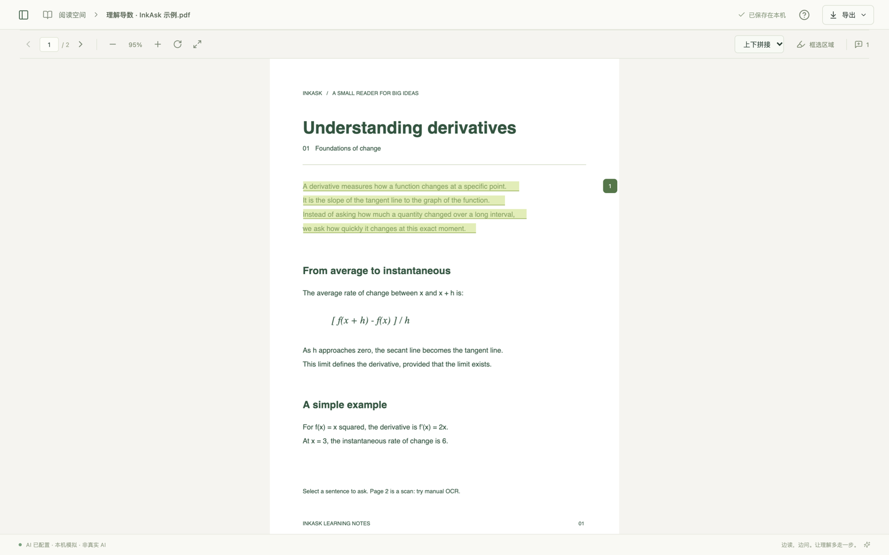
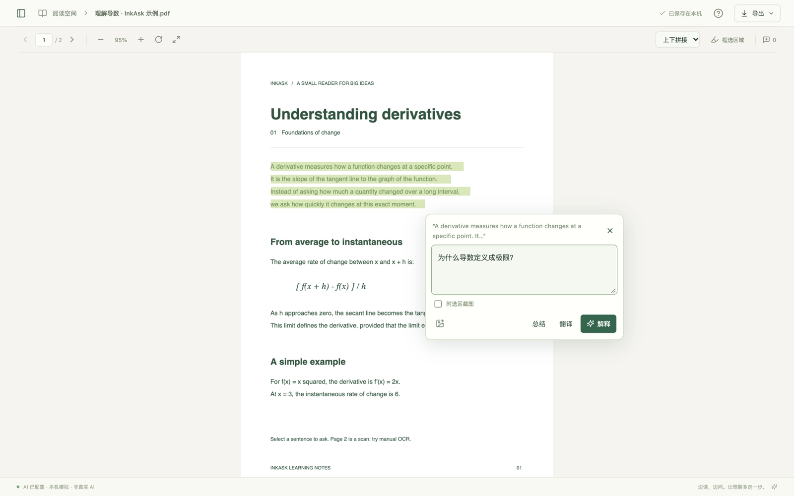
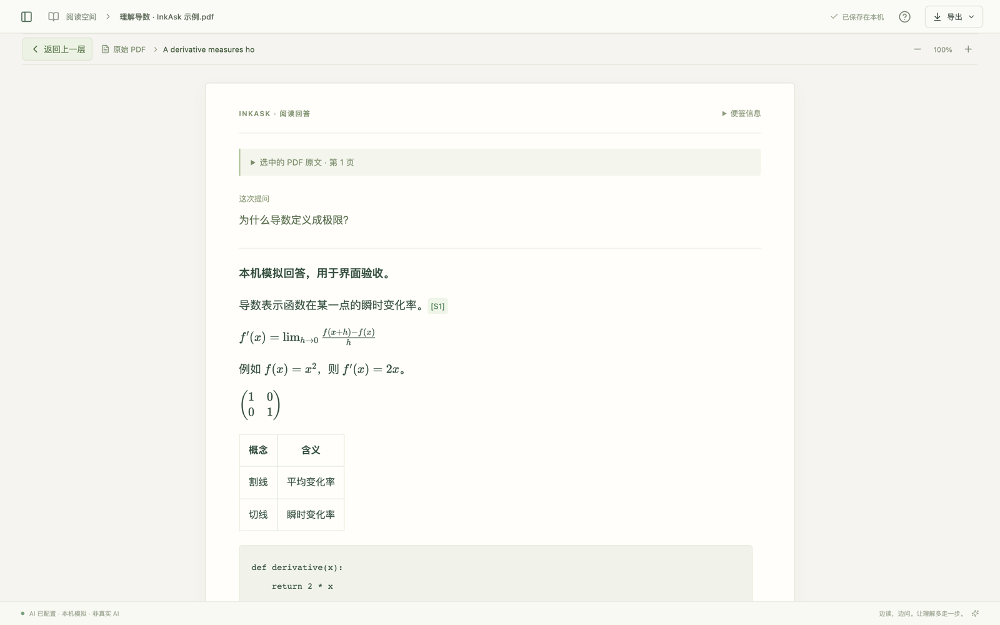
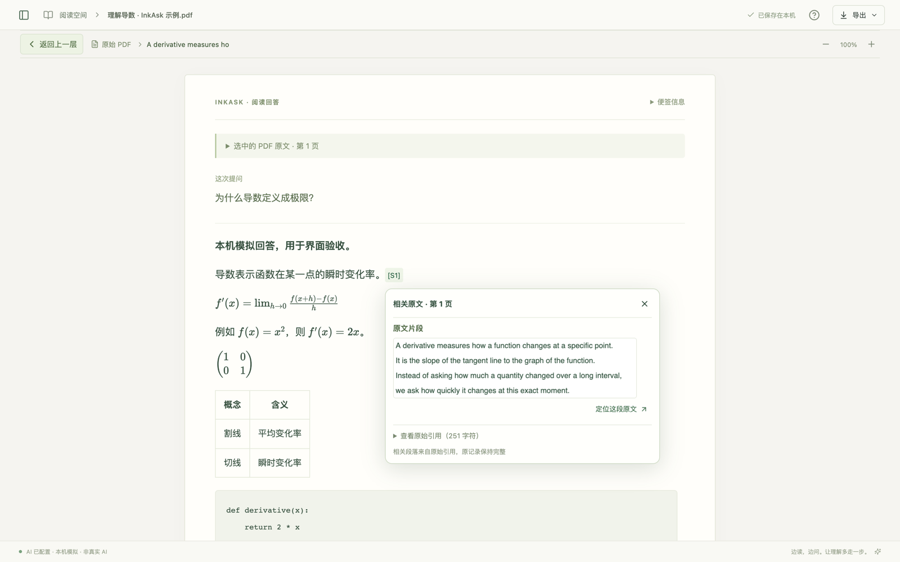
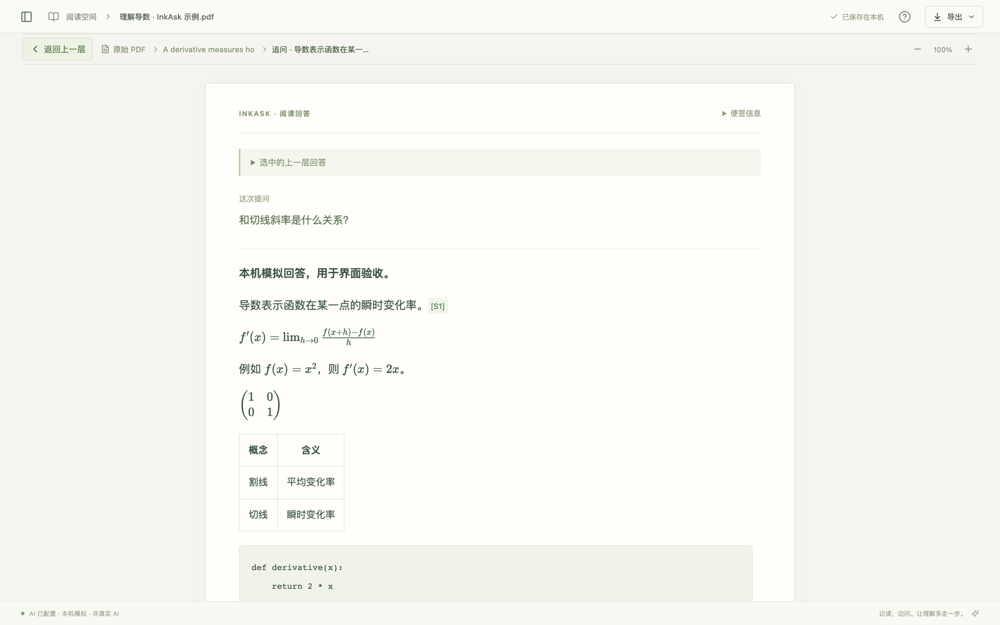
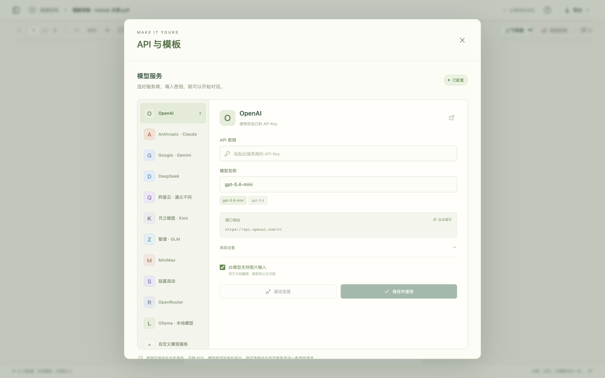

# InkAsk

**在原文旁展开思考的本地 PDF 阅读工作台。**

读 PDF 时选中一句话、一段公式或一幅图，就地提问；回答是一份同样可选文的 Markdown 文档，可以继续追问，长成一棵可回溯的阅读树。文档、笔记、OCR 与截图默认只留在你的电脑上。



## 三分钟上手

1. **打开 PDF**：点击「打开 PDF」或直接拖入。页面无间隔连续排列，可切换上下 / 左右拼接，⌘/Ctrl + 滚轮缩放。首次可点「先打开示例资料」——第 2 页是扫描页，正好试 OCR。
2. **选中提问**：选中文字后，在浮窗里输入问题，点「解释」或按 ⌘/Ctrl + Enter；留空则解释所选内容。也可以「框选区域」直接问图表。
3. **继续追问**：在回答里再选一段，进入下一层；「返回上一层」或顶部层级链可回到 PDF / 任一层回答，原来的滚动位置会恢复。

## 功能

- **连续阅读**：全文无缝拼接、页码定位、缩放旋转；长文档只渲染阅读位置附近的页面，原始 PDF 不会被改写。
- **划词即问**：浮窗支持提问、总结、翻译，可附选区截图或粘贴图片；扫描页可直接框选图表发问。
- **本地 OCR**：文本页自动隐藏 OCR；扫描页按需「识别本页」，Tesseract WASM 与中英语言包在本地运行，页面不外传，识别结果成为可选中文字层。
- **回答页**：Markdown、行内 / 独立公式、矩阵、表格、代码块与图片；流式输出，可随时停止或重试；回答中的文字同样可以选中。
- **树状追问**：每层回答是一条便签，在原处保留高亮与编号；面包屑逐层回溯，不另设文末子列表。
- **引用可核验**：`[S1]` 悬停预览对应原文截图（无法精确匹配时退化为文字摘录），只有「定位原文」才跳转高亮；「本次参考来源」区分真正引用与提供给模型的上下文。
- **资料空间**：文件夹、搜索、网格 / 列表、多选、拖拽、剪切粘贴；便签随资料移动；可导出 / 导入完整项目 `.inkask`。
- **笔记也是文件**：「导出 → 笔记目录」把一条便签写成一个 Markdown（front matter 带页码、任务、父便签），附 README 索引树、原 PDF 与截图，可直接进 Git 并全文检索；格式见 [docs/note-export.md](docs/note-export.md)。
- **模型自选**：OpenAI、Anthropic、Gemini、DeepSeek、通义千问、Kimi、智谱、MiniMax、硅基流动、OpenRouter、Ollama 或任意兼容端点；提示词模板随项目保存与导出。
- **本地优先且落盘**：笔记、PDF 与截图由本机服务写进 `.inkask/`（清浏览器数据不会丢），密钥也只在本机；服务只监听 `127.0.0.1`。

## 界面

> 截图来自 `tests/browser-server.ts` 的确定性验收服务：回答由本机模拟模型生成，不会调用外部 AI。

### 划词提问

选中原文后浮窗贴着选区出现，可输入问题，也可以直接点「总结」「翻译」；「附选区截图」会把选中区域一并发送。



### 回答与引用

回答按 Markdown 渲染，公式、矩阵、表格与代码都能直接阅读；`[S1]` 等编号对应原文片段，悬停预览，点「定位原文」回到 PDF 并高亮。





### 树状追问

在回答中继续选文提问，就得到下一层便签；顶部层级链可以跳回任一祖先，编号仍然留在对应的原文 / 回答位置。



### 模型配置

「API 与模板」里选择服务商，填入自己的 Key 与模型名称，测试连接后「保存并使用」即生效；各服务商的配置分别保留，可随时切换。



## 快速开始

需要 Node.js 22 或更高版本。

```sh
npm ci
npm run dev      # 开发模式：http://127.0.0.1:5173
```

构建后运行（与发布包一致）：

```sh
npm run build
npm start        # http://127.0.0.1:8787
```

数据默认写在当前目录的 `.inkask/`（备份复制它即可；`INKASK_DATA_DIR=/some/disk npm start` 可改）。

macOS 也可以双击 **启动 InkAsk.command**：先体检 Node 版本、依赖与运行资源，再后台启动服务，并提供状态、启停、日志、重建、开发模式面板（`--help` 查看命令行用法；日志与 PID 在 `~/Library/Logs/InkAsk`）。Windows 双击 **start-windows.cmd**。

### 配置模型（可选）

右上角 **? → API 与模板**：选服务商 → 填 API Key 与模型名称 →「测试连接」→「保存并使用」。测试会发出一次真实请求（可能计费），但不保存配置。

- 接口地址按密钥所属地域选择，更换地址后需重新填写密钥；服务地址须为 HTTPS，本机回环地址可用 HTTP。高级设置可切换 Responses、Chat Completions、Anthropic Messages。
- 「支持图片输入」应与模型实际能力一致；模型 ID 以账户可用为准。
- 也可复制 `.env.example` 为 `.env`，填 `OPENAI_API_KEY` / `OPENAI_MODEL`（可选 `OPENAI_BASE_URL`）作为回退；仅当页面没有保存任何服务时生效，改完需重启服务。
- 未配置模型时，PDF、OCR、便签草稿、模板与项目备份仍可使用，界面不会伪造 AI 回答。

## 数据与隐私

- **笔记落在磁盘上**：项目和附件由本机服务写进 `.inkask/`——`projects/<id>/project.json` 存便签与回答，`blobs/<sha256>` 按内容寻址存 PDF、选区截图与附图，`workspace.json` 存文件夹与归属。附件同一份内容只存一次，删除资料会回收没人引用的附件。细节见 [docs/storage.md](docs/storage.md)。
- 数据目录默认是启动目录下的 `.inkask/`，可用 `INKASK_DATA_DIR` 指到别处；备份就是复制这个目录。设置面板里的「本机存储」显示当前位置与体积。阅读位置、缩放与拼接方向仍在浏览器本机偏好里。
- API 配置同样在 `.inkask/providers.json`（目录 `0700`、文件 `0600`）。密钥明文保存在这个受限文件中，页面只显示是否已配置，不回显密钥。
- 本地服务校验 Host / Origin，只监听 `127.0.0.1`。提问时仅发送本次提示词、相关文档片段、分支历史和附带的截图，不会上传整份 PDF；检索只覆盖已提取文字的页面。
- 第一次用新版启动时，会把浏览器里已有的项目复制到磁盘（**不删除**旧数据），完成前保存失败不会写坏任何一边。服务没起来时只能只读浏览器里那份旧数据，保存会明确报错。开发地址 `5173` 与构建后地址 `8787` 看到的是同一份磁盘数据，不必再导出导入。`.env` 与 `.inkask/` 已被 Git 忽略。

## 开发与验证

技术栈：React 19 + Vite、Fastify、pdf.js、Tesseract.js、Dexie（IndexedDB）。

```sh
npm run check    # TypeScript
npm test         # 使用模拟模型，不消耗真实调用
npm run build
```

- UI 验收：运行 `npx tsx tests/browser-server.ts` 后打开 <http://127.0.0.1:8790>。该服务使用独立临时配置与确定性模拟回答，页面标注「本机模拟 · 非真实 AI」。
- 落盘与迁移见 [docs/storage.md](docs/storage.md)；引用与证据检索设计见 [docs/evidence-citations.md](docs/evidence-citations.md)；笔记目录格式见 [docs/note-export.md](docs/note-export.md)；大文档性能见 [docs/reader-performance.md](docs/reader-performance.md)；历史验证记录见 [VALIDATION.md](VALIDATION.md)。
- 把 `.inkask` 直接摊成笔记目录（不进浏览器，落盘即可 `git add`）：`npm run export:notes -- <项目.inkask> <输出目录>`，可选 `--no-pdf` / `--no-assets`。
- 示例 PDF 可用 `npm run sample` 重新生成；非 macOS 环境重建示例时，可用 `INKASK_CJK_FONT` 指定中文字体。

## 边界

个人本机使用：没有账号、跨设备同步、手写、语音或图片生成。数据跟着启动目录走，从两个目录各起一份就有两份 `.inkask/`；跨机器请复制目录或导出 `.inkask`。OCR 与公式识别可能出错，可校正文字或改附截图；模型能力与计费以服务商为准。
